# LUMEN
### Plataforma segura de entrega y verificación de resultados de Papanicolaou
> *Resultados con claridad, seguridad y acompañamiento.*

Prototipo para el **Reto 4 de EIRA Movimiento Rosa A.C.** · Nerdearla Vibeathon México 2026 · Licencia MIT.

> ⚠️ **Todos los datos son ficticios.** Ninguna persona, laboratorio, teléfono, correo, CURP ni PDF corresponde a pacientes reales. La IA de LUMEN **no diagnostica, no interpreta resultados y no decide nada**: solo lee identificadores, detecta problemas de calidad, sugiere candidatas y ordena filas. Toda entrega exige **revisión administrativa + autorización clínica humanas**.

🇺🇸 [English summary](#-english-summary) · 🇲🇽 Documento principal en español

**Demo en vivo:** https://lumen-3zsd.onrender.com · **Repositorio:** https://github.com/estercpaulino2007/lumen

---

## 📸 Recorrido visual (demo con datos ficticios)

| | |
|---|---|
| 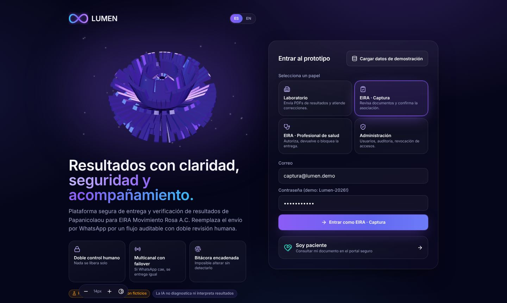 **1. Portada** — acceso por papel, escultura 3D, ES/EN | 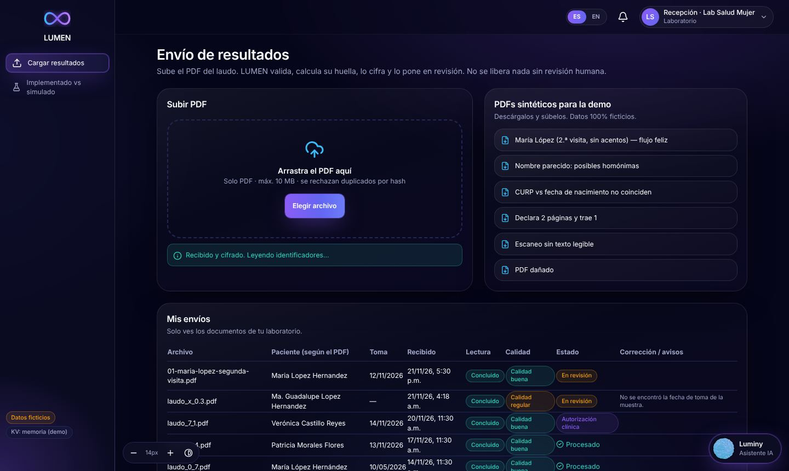 **2. Laboratorio** — sube el PDF y ve qué se leyó (paciente, toma, calidad) |
| 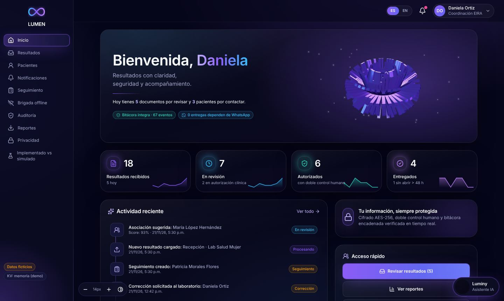 **3. Centro de Entrega** — indicadores, embudo, municipios, actividad | 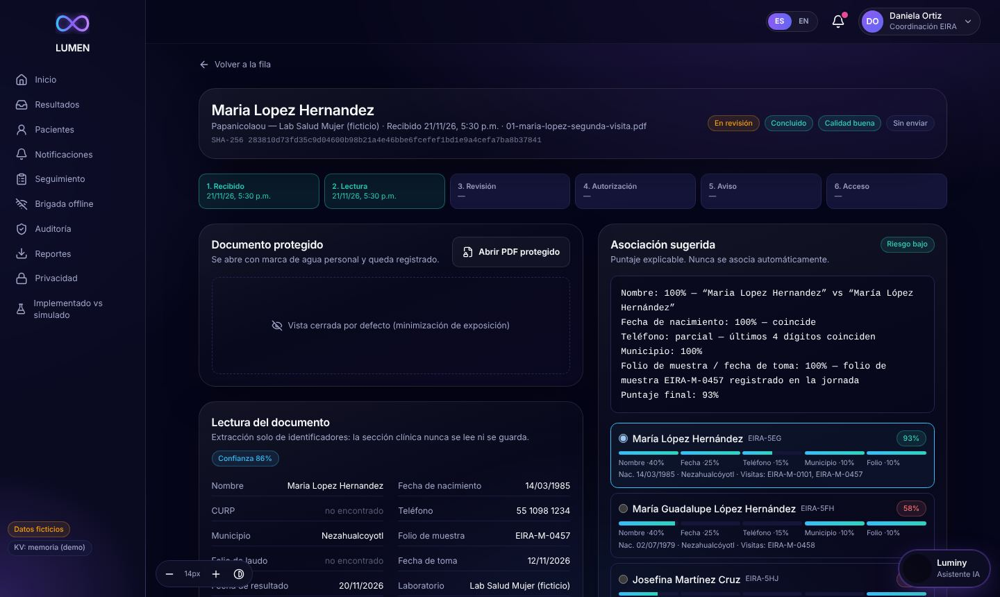 **4. Asociación** — puntaje explicable 40/25/15/10/10 y homónimas |
| 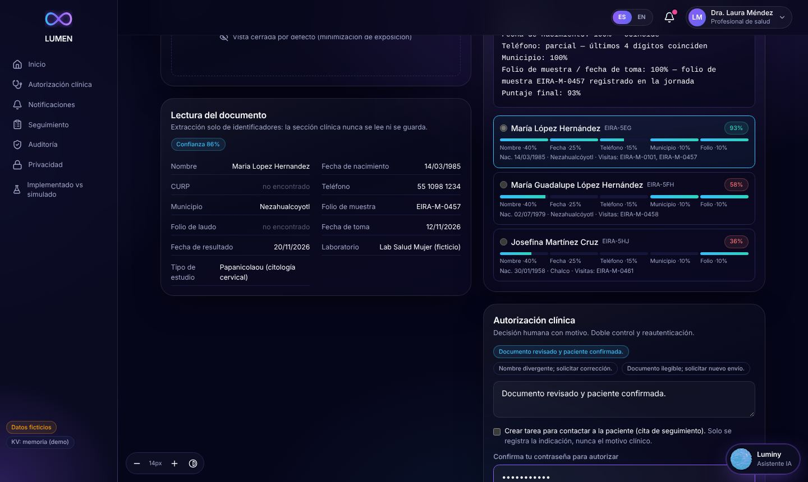 **5. Autorización clínica** — otra persona, motivo y contraseña | 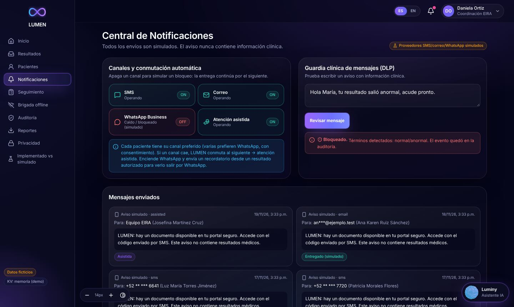 **6. Notificaciones** — failover de canales y guardia clínica |
| 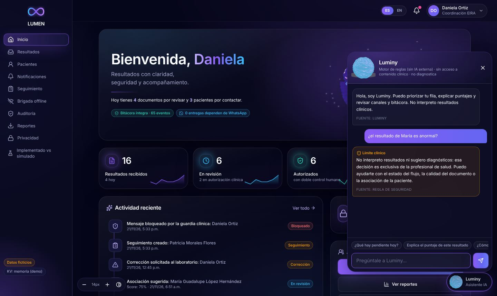 **7. Luminy** — asistente IA con límite clínico | 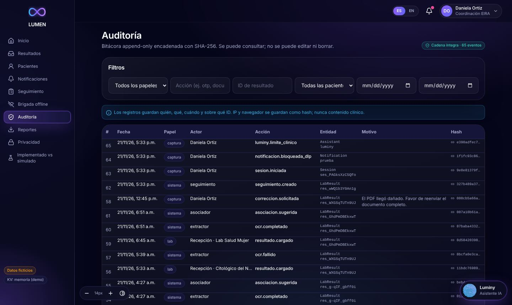 **8. Auditoría** — bitácora encadenada |

| Portal de la paciente (móvil) | | |
|---|---|---|
| 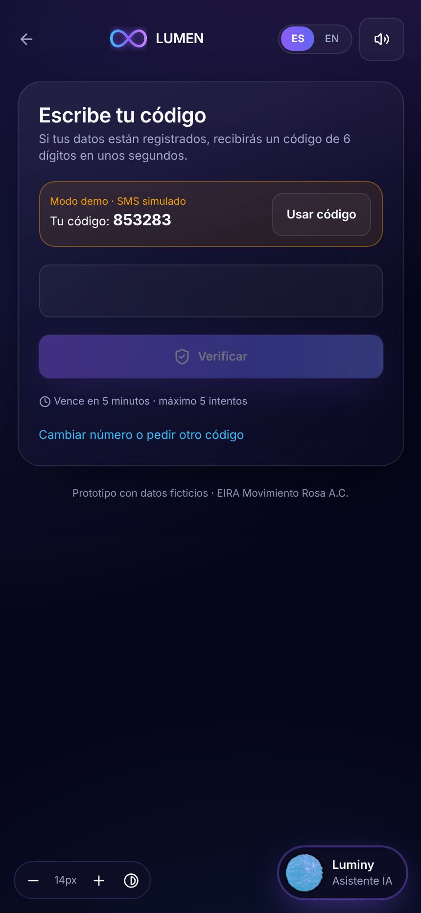 **9. Código** (en demo se muestra en pantalla) | 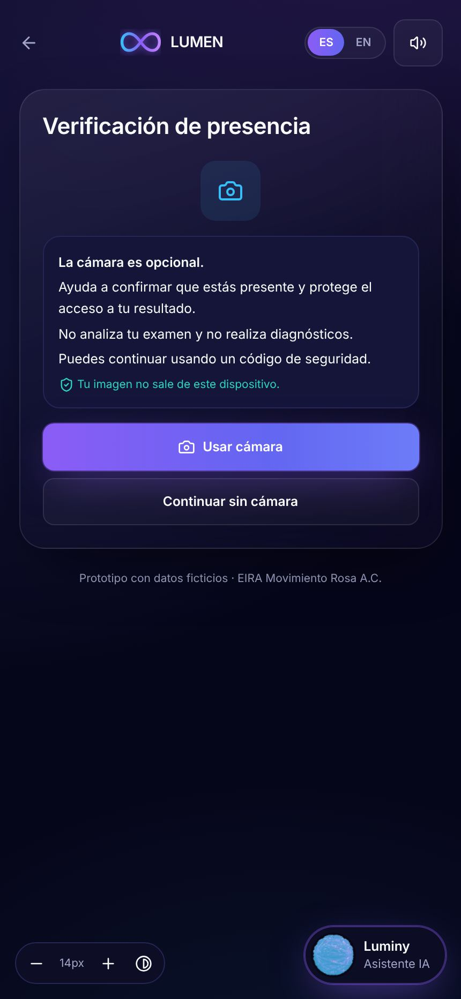 **10. Verificación de presencia** opcional | 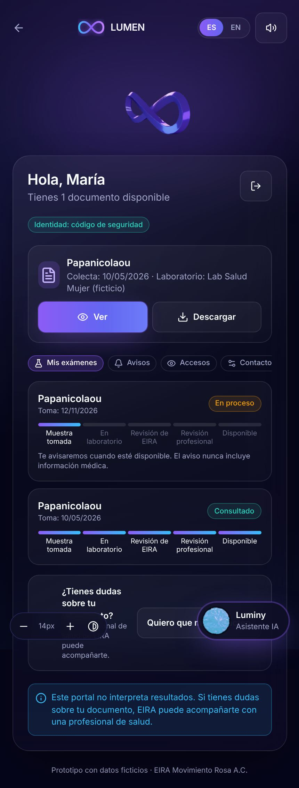 **11. Mis exámenes, avisos, accesos y contacto** |

### Guion rápido para probarla (3 minutos)
1. **Laboratorio** (`lab@lumen.demo`): *Cargar resultados* → descarga `01-maria-lopez-segunda-visita.pdf` de la misma pantalla y súbelo.
2. **Captura** (`captura@lumen.demo`): *Resultados* → abre el documento → puntaje 93 % → *Confirmar asociación*.
3. **Profesional de salud** (`clinica@lumen.demo`): *Autorización clínica* → motivo + contraseña → *Autorizar entrega*.
4. **Notificaciones**: el aviso salió por SMS porque WhatsApp está caído; escribe "tu resultado salió anormal" en la guardia → *Bloqueado*.
5. **Paciente**: *Soy paciente* → María López → *Usar código* → cámara (opcional) → *Ver*. Revisa *Mis exámenes*, *Avisos*, *Accesos* y *Contacto*.
6. **Luminy**: "¿Qué hay pendiente hoy?", "¿cómo agrego un usuario?" y "¿el resultado de María es anormal?".

Contraseña de todos los papeles: `Lumen-2026!`


## 1. Problema

Hoy el laboratorio entrega resultados impresos, EIRA los escanea, los asocia **por nombre** y los envía **por WhatsApp** (más de 300 al mes). Esto genera tres riesgos:

1. **Paciente equivocada**: homónimas y errores de captura ("Ma. Guadalupe" vs "María").
2. **Exposición de datos de salud**: un PDF clínico circulando por un chat sin control de acceso.
3. **Interrupción total**: cuando la cuenta de WhatsApp se bloquea, las entregas se detienen y nadie da seguimiento.

## 2. Qué hace LUMEN

```
Laboratorio sube PDF → huella SHA-256 + cifrado → lectura de identificadores (ciega a lo clínico)
→ puntaje de asociación explicable → confirmación humana (EIRA) → autorización clínica (otra persona)
→ aviso neutro multicanal con guardia DLP → OTP de la paciente → verificación de presencia opcional
→ enlace firmado de 5 min ligado a su sesión → PDF con marca de agua → seguimiento si no lo abre
→ bitácora encadenada de todo
```

### Público
| Papel | Qué hace |
|---|---|
| Laboratorio | Sube PDFs, ve solo sus envíos, atiende correcciones |
| EIRA · Captura | Revisa lectura y calidad, confirma/rechaza asociación, pide correcciones, registra pacientes, códigos asistidos, exporta |
| EIRA · Profesional de salud | Autoriza, devuelve o bloquea (con motivo y reautenticación) |
| Paciente | Entra con OTP o código asistido, ve/descarga solo lo suyo |
| Administración | Usuarios, sesiones, revocación de enlaces, políticas, auditoría completa |

## 3. Innovaciones (más allá de lo pedido)

| | Innovación | Por qué importa |
|---|---|---|
| 📡 | **Orquestador multicanal con failover** (SMS → correo → WhatsApp Business con plantilla neutra → atención asistida) | Ataca la causa raíz: si WhatsApp se bloquea, la entrega sigue. Se demuestra apagando el canal en vivo. |
| 🛡️ | **Guardia clínica DLP** en todo aviso saliente | Imposible enviar "resultado anormal", "VPH", "lesión", etc., aunque alguien lo escriba a mano. Queda auditado. |
| 🔗 | **Bitácora encadenada por hash** (como un libro contable) | Borrar o editar un evento rompe la cadena; el panel muestra "Bitácora íntegra" en tiempo real. |
| 🇲🇽 | **Validación real de CURP** (estructura RENAPO + dígito verificador) | Detecta errores del laboratorio: "la fecha de nacimiento no coincide con la codificada en la CURP". |
| 👯 | **Detección de homónimas** | Si dos candidatas están a menos de 15 puntos, el riesgo sube a "alto" aunque el puntaje sea 90 %. |
| 🙈 | **Lectura ciega a lo clínico** | El extractor solo lee etiquetas administrativas; la sección de resultado nunca se lee ni se guarda. |
| 👥 | **Doble control (cuatro ojos)** | Quien confirma la asociación no puede autorizar la entrega; autorizar exige reingresar contraseña. |
| 📎 | **Enlaces ligados a la sesión** | Si la paciente reenvía el enlace, no funciona en otro dispositivo (probado: responde 401). |
| 📱 | **Verificación de presencia en el dispositivo** (face-api.js, parpadeo o giro de cabeza) | La imagen y el vector facial **nunca salen del navegador**; solo se registra aprobado/no aprobado. |
| 🎟️ | **Código asistido imprimible** | Para pacientes sin celular, correo o internet: ticket de un solo uso + fecha de nacimiento, con personal de EIRA. |
| 🔊 | **"Escuchar instrucciones"** (voz en español) | Accesibilidad para baja alfabetización digital. |
| 📊 | **Contexto con datos públicos reales** | INEGI (EDR 2024): 4,646 muertes por cáncer cervicouterino; GLOBOCAN 2024: 11,919 casos nuevos estimados. |
| ✨ | **Luminy, asistente de IA** (avatar 3D: orbe + technotron, se gira con el mouse) | Base de conocimiento de todo el app en ES/EN ("¿cómo agrego un usuario?", "how do I export a report?"), resúmenes con datos en vivo, explicación de puntajes, canales y bitácora. Se niega a interpretar resultados y le ofrece a la paciente "quiero que una profesional me contacte". Con `ANTHROPIC_API_KEY`, responde preguntas generales y **busca en la web**; recibe solo datos agregados y su salida pasa por la guardia DLP. |
| 🌐 | **Español / English** | Selector ES/EN en todas las pantallas (login, panel y portal). Español por defecto para el público de EIRA; inglés para aliados y jurado. |
| 🌌 | **Interfaz con 3D en tiempo real** (three.js / React Three Fiber) | Escultura en banner y login, lazo infinito en el portal; se pueden girar arrastrando. Modelos comprimidos de 6,5 MB a <600 KB; respaldo en CSS si no hay WebGL o con movimiento reducido. |
| 🙋 | **Portal completo para la paciente** | Estado de cada examen (muestra tomada → laboratorio → revisión EIRA → revisión profesional → disponible), avisos recibidos, **quién abrió su documento** (transparencia), canal preferido y botón para que una profesional la contacte. Nunca muestra contenido clínico. |
| 👥 | **Gestión de usuarios** | La Administración crea cuentas (contraseña temporal mostrada una sola vez), desactiva usuarios y revoca sesiones y enlaces. |
| 📈 | **Indicadores propios de EIRA** | Embudo de entrega, municipios atendidos, avisos rescatados por failover, intentos con WhatsApp bloqueado y mensajes frenados por la guardia; saludo y fila según el papel. |
| 📴 | **Brigada offline** con fila IndexedDB y conflictos por campo | Nada se sobrescribe en silencio; la resolución queda auditada. |

## 4. Arquitectura

```
Next.js 15 (App Router, TypeScript, Tailwind, SWR, Recharts, Lucide)
 ├── app/(staff)/*      Pantallas de personal (RBAC en el backend)
 ├── app/portal         Portal de paciente (móvil primero)
 ├── app/api/*          API Routes: zod + CSRF + RBAC + auditoría
 └── lib/
     ├── flow.ts        Flujo de dominio (lo usan la API y la semilla)
     ├── extract.ts     pdf.js: identificadores + controles de calidad
     ├── match.ts       Puntaje explicable 40/25/15/10/10 + homónimas
     ├── curp.ts        Validación real de CURP
     ├── notify.ts      Orquestador multicanal con failover
     ├── dlp.ts         Guardia clínica de mensajes
     ├── audit.ts       Bitácora append-only encadenada (JSONL)
     ├── crypto.ts      AES-256-GCM, HMAC, enlaces firmados, seudónimos
     ├── storage.ts     Interfaz de almacenamiento (local cifrado → S3)
     ├── kv.ts          OTP/límites/bloqueos: Valkey si hay VALKEY_URL, si no memoria
     ├── queue.ts       Interfaz de fila (memoria → Valkey Streams/BullMQ)
     └── store.ts       Almacén JSON atómico con el modelo de docs/schema.prisma
```
Detalle y decisiones: [ARCHITECTURE.md](ARCHITECTURE.md).

**Tecnologías:** three.js + React Three Fiber + drei (3D), Next.js 15, React 19, TypeScript, Tailwind CSS 3, SWR, Recharts, Lucide React, Zod, bcryptjs, pdf-lib, pdf.js (pdfjs-dist), Dexie (IndexedDB), face-api.js (CDN, en el navegador), iovalkey (opcional), Vitest.

## 5. Cómo correrlo

Requisitos: **Node.js 18.18+** (recomendado 20 o 22).

```bash
npm install
npm run dev            # http://localhost:3000
```
1. Abre `http://localhost:3000` y pulsa **"Cargar datos de demostración"** (o `npm run seed` con el servidor encendido).
2. Elige un papel y entra.

Producción local: `npm run build && npm start`. Pruebas: `npm test` (14 pruebas de CURP, puntaje, DLP y criptografía).

### Variables de entorno (`.env.local`, opcionales)
| Variable | Uso |
|---|---|
| `LUMEN_MASTER_KEY` | 64 hex. Deriva cifrado, firmas y seudónimos. Sin ella se usa una clave de demo (aviso en consola). |
| `VALKEY_URL` | `redis://localhost:6379`. OTP, rate limiting y bloqueos en Valkey (expiran solos y no tocan disco). |
| `LUMEN_DEMO_MODE` | `true` (por defecto): habilita la carga de demo y muestra el OTP simulado en la Central de Notificaciones. |
| `ANTHROPIC_API_KEY` | Opcional: IA generativa para Luminy con búsqueda web (modelo por defecto `claude-haiku-5-5`, cambiar con `LUMINY_MODEL`; desactivar la búsqueda con `LUMINY_WEB_SEARCH=false`). |
| `LUMINY_API_KEY` / `LUMINY_BASE_URL` / `LUMINY_MODEL` | Opcional: cualquier API compatible con OpenAI (OpenAI, Groq, OpenRouter). |
| `LUMEN_INSECURE_COOKIES` | `1` solo si demuestras con `npm start` desde otro dispositivo por `http://IP-LAN` (en `npm run dev` no hace falta). |

### 🚀 Demo en vivo en Render

**URL de la demo:** https://lumen-3zsd.onrender.com

**Cómo se desplegó (Blueprint, sin configurar nada a mano):**
1. En https://dashboard.render.com → **Blueprints → New Blueprint Instance** → repositorio `estercpaulino2007/lumen`, rama `main`.
2. Render lee `render.yaml`: Node 22, `npm ci && npm run build`, `npm run start:render`, health check en `/api/auth/me` y una `LUMEN_MASTER_KEY` generada automáticamente.
3. **Apply** → en 3–6 min el servicio queda *Live*. Cada `git push` a `main` vuelve a desplegar solo.
4. Abrir la URL → **Cargar datos de demostración** → elegir un papel.

**Cómo probarla como jurado:**
- **Personal de EIRA:** elegir un papel en la portada (contraseña `Lumen-2026!`).
- **Paciente:** botón *Soy paciente* → elegir *María López* → *Recibir código*. Como el SMS es simulado, en modo demo el código aparece en pantalla (*Usar código*). Después: verificación de presencia por cámara (opcional; el detector se sirve desde el propio app, sin CDN; acepta parpadeo o giro de cabeza) → *Ver* / *Descargar*.
- **Usuarios:** como Administración → *Usuarios y accesos* → *Agregar usuario*.
- **Luminy:** botón inferior derecho; prueba "¿Qué hay pendiente hoy?", "¿cómo agrego un usuario?" y "¿el resultado de María es anormal?" (límite clínico).
- **WhatsApp bloqueado:** María prefiere WhatsApp, pero el canal está caído por defecto; el aviso sale por SMS y la *Central de Notificaciones* muestra el failover. Encender WhatsApp ahí cambia el canal en el siguiente aviso.

**Notas del plan gratuito de Render:**
- El servicio se duerme tras ~15 min sin uso; la primera visita tarda ~50 s en despertar.
- El disco es efímero: al reiniciar se pierden los datos de demo → volver a pulsar *Cargar datos de demostración*.
- IA generativa de Luminy (opcional): *Environment* → `ANTHROPIC_API_KEY` (incluye búsqueda web) o `LUMINY_API_KEY` (+ `LUMINY_BASE_URL`, `LUMINY_MODEL`, sin búsqueda web). Sin clave, Luminy responde con su base de conocimiento y datos en vivo.
- Para producción: plan con disco persistente o PostgreSQL (`docs/schema.prisma`), almacenamiento S3 y Valkey administrado (ver `ROADMAP.md`).

Valkey opcional: `docker run -p 6379:6379 valkey/valkey` y `VALKEY_URL=redis://localhost:6379`.

### Credenciales ficticias (contraseña `Lumen-2026!`)
| Papel | Correo |
|---|---|
| Laboratorio | `lab@lumen.demo` (y `lab2@lumen.demo`) |
| EIRA · Captura | `captura@lumen.demo` |
| EIRA · Profesional de salud | `clinica@lumen.demo` |
| Administración | `admin@lumen.demo` |
| Paciente | Portal → `55 5123 1234` (María López) o `anakaren.ruiz@ejemplo.test` |

### Datos de demostración
10 pacientes, 3 laboratorios y 12 resultados en todas las etapas, incluidos: 2 nombres parecidos (homónimas), 1 PDF dañado, 1 resultado sin fecha de toma, 1 paciente sin teléfono (aviso por correo), 1 sin celular ni internet (entrega asistida), 1 aviso sin abrir por más de 48 h (seguimiento automático) y 1 contacto indicado por la profesional. Además, `public/samples/` trae 6 PDFs sintéticos para subir en vivo.

## 6. Flujo de la demo (2 minutos)
Ver [DEMO.md](DEMO.md).

Créditos de los modelos 3D: [CREDITS.md](CREDITS.md).

## 7. Implementado vs. simulado

**Implementado y funcionando:** carga con validación (extensión, MIME, firma `%PDF`, 10 MB, SHA-256, duplicados); cifrado AES-256-GCM en reposo; extracción de identificadores con pdf.js y controles de calidad (PDF dañado, página ausente, sin texto, fechas incoherentes, CURP inválida, CURP vs. fecha, duplicado por folio); puntaje explicable; confirmación/rechazo/revisión manual/corrección; doble control; reautenticación; RBAC en backend; sesiones con cookie HttpOnly/SameSite, expiración, inactividad e invalidación; CSRF; rate limiting; OTP con HMAC, 5 min, 5 intentos y bloqueo de 15 min; código asistido; enlaces firmados de 5 min, 3 usos, ligados a sesión y revocables; marca de agua dinámica; guardia DLP; failover multicanal; seguimiento automático 48 h; bitácora encadenada con verificación; exportación CSV/JSON anonimizada o identificada con motivo; fila offline con conflictos; verificación de presencia con face-api.js; accesibilidad (tamaño de letra, alto contraste, teclado, voz).

**Simulado (y rotulado en la interfaz):** proveedores de SMS, correo y WhatsApp (los mensajes se ven en la Central de Notificaciones); caídas de canal (interruptor); OCR de imágenes escaneadas (se marca "requiere OCR"); la "otra brigada" del conflicto offline (botón); la cámara tiene una simulación rotulada si el modelo no carga sin internet; integración con sistemas de laboratorio.

## 8. Seguridad, privacidad y riesgos
- [SECURITY.md](SECURITY.md): controles, amenazas, riesgos residuales.
- [PRIVACY.md](PRIVACY.md): minimización, consentimiento, retención y acceso.

**Limitaciones:** almacén JSON de un solo proceso (no apto para concurrencia real; el schema de PostgreSQL está en `docs/schema.prisma`); sin OCR de imagen; sin proveedor real de mensajería; la verificación de presencia no es biometría de identidad; no hay pruebas de penetración; no se afirma cumplimiento normativo.

## 9. Costos estimados para un piloto (≈300 entregas/mes)
*Estimaciones de orden de magnitud, a cotizar con proveedores locales.*

| Concepto | Estimado mensual |
|---|---|
| Hosting de la app (contenedor pequeño) | USD 10–25 |
| PostgreSQL administrado | USD 15–30 |
| Almacenamiento S3-compatible cifrado (pocos GB) | < USD 5 |
| Valkey administrado (opcional) | USD 0–15 |
| SMS (≈2 por entrega: aviso + OTP ≈ 600) | a cotizar; el principal costo variable |
| Correo transaccional | nivel gratuito |
| **Total aproximado sin SMS** | **USD 30–75** |

Sin licencias propietarias: todo el stack es open source.

## 10. Próximos pasos
Ver [ROADMAP.md](ROADMAP.md). Resumen: PostgreSQL + S3 + KMS, proveedor de SMS con plantilla aprobada, OCR de imagen, integración con laboratorio, prueba de usabilidad con brigadas y pacientes, evaluación legal (LFPDPPP, NOM-004-SSA3-2012, NOM-024-SSA3-2012) y pruebas de seguridad externas.

## 11. Preguntas abiertas para validar con EIRA
1. ¿Qué identificadores trae **siempre** el PDF del laboratorio (folio de muestra, CURP, fecha de nacimiento)? ¿Podemos acordar un folio de muestra impreso en la jornada?
2. ¿Quién firma la autorización clínica hoy y cuántas personas podrían hacerlo (para el doble control)?
3. ¿Qué porcentaje de pacientes no tiene celular propio o comparte el teléfono con familiares? ¿Qué canal prefieren?
4. ¿El laboratorio aceptaría subir PDFs a un portal o necesita un buzón de correo/SFTP?
5. ¿Cuánto tiempo deben conservarse los PDFs y quién puede pedir su eliminación?
6. ¿Qué hace hoy el equipo cuando un resultado requiere cita de seguimiento? ¿Quién llama y desde dónde?
7. ¿Hay un aviso de privacidad vigente y un formato de consentimiento que debamos reutilizar?
8. ¿Qué computadoras y conectividad tiene el equipo en las jornadas?
9. ¿Interesa la verificación por cámara o genera desconfianza en las comunidades?
10. ¿Qué indicadores piden los donantes y aliados (para el informe exportable)?

---

## 🇺🇸 English summary

**LUMEN** replaces WhatsApp delivery of Pap smear results with a secure, auditable flow for **EIRA Movimiento Rosa A.C.** (Mexico). The lab uploads the PDF; LUMEN fingerprints it (SHA-256), encrypts it at rest (AES-256-GCM), extracts **only identifiers** (never the clinical section) and suggests the matching patient with an **explainable score** (40% name, 25% date of birth, 15% phone, 10% municipality, 10% sample ID / collection date), including namesake detection and real Mexican CURP validation. **Nothing is released automatically:** an EIRA staff member confirms the match and a different person, a health professional, authorizes delivery with a reason and password re-authentication.

The patient receives a **neutral notice** (checked by a clinical DLP guard so it never contains medical information) through a **multichannel orchestrator with automatic failover** (SMS → email → WhatsApp Business → assisted service), so deliveries continue even if WhatsApp is blocked. She signs in with a one-time code or a printed **assisted code** (for patients without a phone or internet), can do an optional **on-device presence check** (the image never leaves the device), and opens the PDF through a **5-minute signed link bound to her session**, with a dynamic watermark. If she doesn't open it within 48 h, EIRA gets a follow-up task. Every step goes into a **hash-chained, append-only audit log**.

**Also included:** Luminy, an AI assistant with a draggable 3D avatar and a bilingual knowledge base of the whole app that prioritizes the queue from live data and refuses to interpret results (optional generative AI with web search that only receives aggregated counts); user management (admins create accounts with one-time temporary passwords); EIRA-specific indicators (delivery funnel, municipalities served, notices rescued by failover); an offline brigade mode with per-field conflict resolution; anonymized CSV/JSON export; real public data from INEGI/GLOBOCAN; an **ES/EN language toggle**; and accessibility features (text size, high contrast, keyboard navigation, read-aloud instructions).

**Run locally:** `npm install && npm run dev` → open `http://localhost:3000` → click "Cargar datos de demostración". Every fictitious user's password is `Lumen-2026!`.
**Live demo / deploy:** Render Blueprint using the included `render.yaml` (free plan: first visit after idle takes ~50 s; demo data must be reloaded after a restart). In demo mode the patient's one-time code is shown on screen because SMS is simulated.

**Implemented vs. simulated:** SMS/email/WhatsApp providers, channel outages, OCR of scanned images and the "other brigade" in the offline conflict demo are simulated and labeled in the UI. Everything else really works. No real patient data is used, and no legal compliance is claimed; that belongs to the pilot roadmap.

MIT License.
